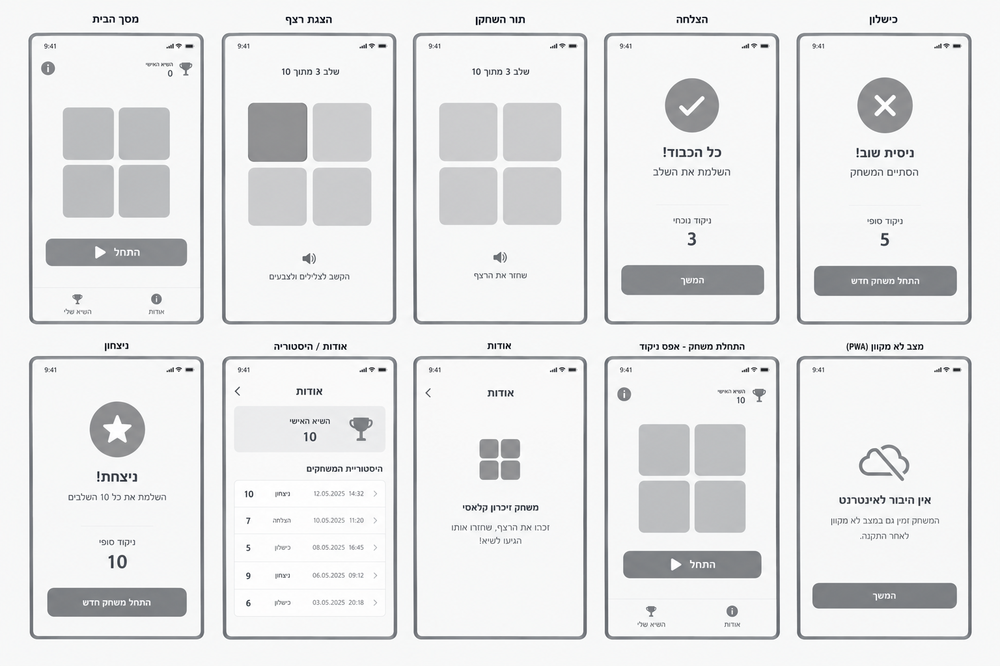
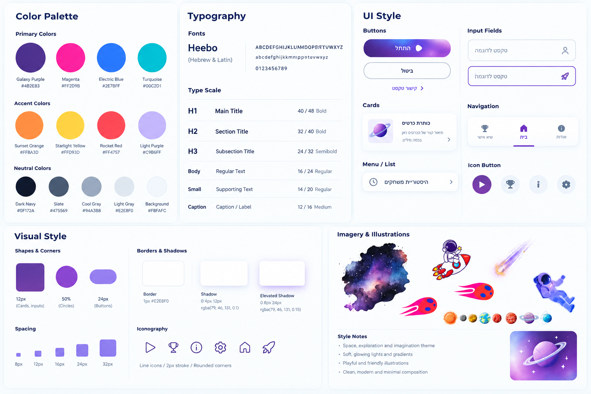
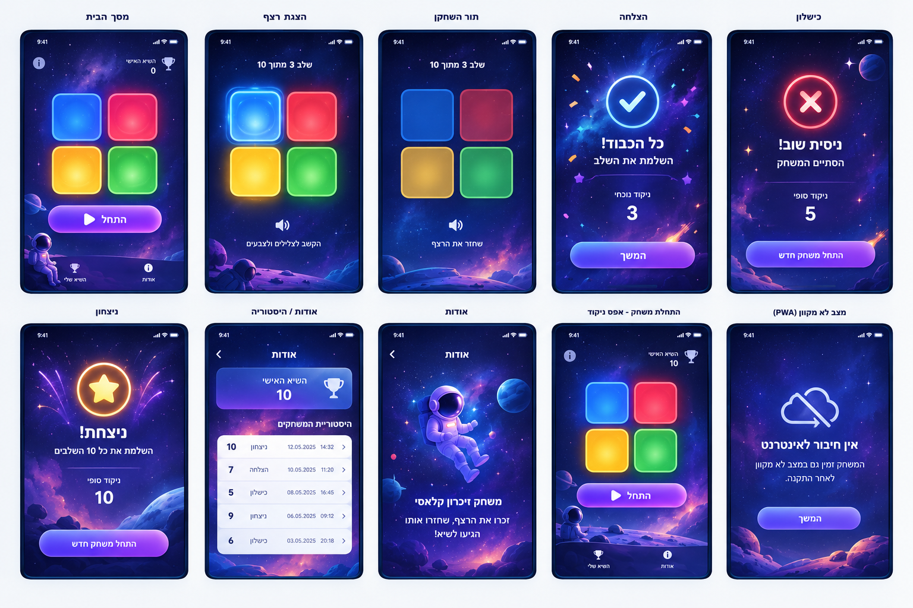

# DESIGN.md — מסמך עיצוב הממשק

## Screens – מסכי האפליקציה

### 1. מסך הבית

**מטרה:** לאפשר התחלת משחק ולספק גישה לשיא האישי ולמסך „אודות”.

**מבנה ותוכן:**
- לוח משחק מרכזי המורכב מארבעה אריחים: כחול, אדום, צהוב וירוק, בפריסה של 2×2.
- כפתור ראשי „התחל” מתחת ללוח.
- בחלק העליון: אייקון מידע וקישור לשיא האישי עם אייקון גביע והניקוד.
- סרגל ניווט תחתון עם „השיא שלי” ו„אודות”.
- ברמת ה-Mockups, הרקע הוא חלל כהה עם כוכבים, ערפיליות וכוכבי לכת; רכיבי המשחק בולטים מעליו.

**פעולות וניווט:**
- לחיצה על „התחל” מאפסת את המשחק ומתחילה רצף חדש.
- „אודות” פותח את מסך אודות, שבו מוצגים השיא והיסטוריית המשחקים.
- קישור השיא מוביל לאזור הנתונים האישיים במסך אודות.

### 2. מסך הצגת הרצף

**מטרה:** להציג לשחקן את רצף הצבעים שעליו לזכור.

**מבנה ותוכן:**
- כותרת שלב בפורמט „שלב X מתוך 10”.
- לוח ארבעת הצבעים בפריסת 2×2.
- בזמן הצגת הרצף, האריח הפעיל מודגש באור ובזוהר חזותי.
- אייקון רמקול וטקסט עזר „הקשב לצלילים ולצבעים”.

**פעולות וניווט:**
- המסך מציג את הצבעים לפי הרצף, עם צליל מתאים לכל צבע.
- בזמן ההצגה אין לקבל לחיצות משחק מהמשתמש.
- עם סיום ההצגה, המשחק עובר למצב שבו המשתמש משחזר את הרצף.

### 3. מסך תור השחקן

**מטרה:** לאפשר לשחקן לשחזר את הרצף באמצעות לחיצה על הצבעים.

**מבנה ותוכן:**
- כותרת שלב „שלב X מתוך 10”.
- לוח ארבעת הצבעים בפריסת 2×2.
- אייקון רמקול וטקסט עזר „שחזר את הרצף”.
- אריחים בעלי צבע מובחן, פינות מעוגלות וקו מתאר זוהר.

**פעולות וניווט:**
- כל לחיצה על אריח נבדקת מול הרצף הצפוי.
- לחיצה נכונה מקדמת את השחזור ומעדכנת את הניקוד.
- לאחר שחזור נכון של הרצף, מתחיל השלב הבא, או שמוצג מצב ניצחון לאחר השלב העשירי.
- לחיצה שגויה מעבירה למצב כישלון.

### 4. מצב הצלחה

**מטרה:** להציג משוב על השלמת שלב בהצלחה.

**מבנה ותוכן:**
- סמל הצלחה גדול במרכז.
- כותרת „כל הכבוד!” וטקסט „השלמת את השלב”.
- אזור ניקוד עם התווית „ניקוד נוכחי” והערך המספרי.
- כפתור ראשי „המשך”.

**פעולות וניווט:**
- לחיצה על „המשך” ממשיכה למשחק ולשלב הבא.
- מצב זה מוצג כחלק מחוויית המשחק, ולא כמסך ניווט עצמאי.

### 5. מצב כישלון

**מטרה:** להודיע שהמשחק הסתיים עקב טעות ולהציג את התוצאה הסופית.

**מבנה ותוכן:**
- סמל X גדול עם הדגשה אדומה.
- כותרת „ניסית שוב!” וטקסט „הסתיים המשחק”.
- אזור „ניקוד סופי” עם התוצאה.
- כפתור ראשי „התחל משחק חדש”.

**פעולות וניווט:**
- המשחק מסתיים לאחר הטעות.
- לחיצה על „התחל משחק חדש” מאפסת את מצב המשחק ומתחילה משחק חדש.
- התוצאה נשמרת בהיסטוריה המקומית בסיום המשחק.

### 6. מצב ניצחון

**מטרה:** לציין השלמה של כל עשרת השלבים ולהציג את הניקוד הסופי.

**מבנה ותוכן:**
- סמל כוכב מרכזי עם אפקט זוהר.
- כותרת „ניצחת!” וטקסט „השלמת את כל 10 השלבים”.
- אזור „ניקוד סופי”.
- כפתור „התחל משחק חדש”.
- רקע חללי עם אפקטים חגיגיים, בהתאם לשפה החזותית של ה-Mockups.

**פעולות וניווט:**
- לחיצה על „התחל משחק חדש” פותחת משחק חדש.
- התוצאה נשמרת בהיסטוריה המקומית והשיא האישי מתעדכן אם הניקוד גבוה יותר.

### 7. מסך אודות / היסטוריה

**מטרה:** להציג את השיא האישי ואת תוצאות המשחקים הקודמים.

**מבנה ותוכן:**
- כותרת „אודות” עם אפשרות חזרה.
- כרטיס שיא אישי עם אייקון גביע והניקוד הגבוה ביותר.
- כותרת אזור „היסטוריית המשחקים”.
- רשימת תוצאות. כל שורה מציגה ניקוד, תוצאה, תאריך ושעה, וכן סמן ניווט.
- אם אין היסטוריה שמורה, יש להציג מצב ריק ברור במקום הרשימה.

**פעולות וניווט:**
- פתיחת המסך נעשית דרך „אודות” במסך הבית.
- פעולת החזרה מחזירה למסך הבית.
- הנתונים נקראים מהאחסון המקומי.

### 8. מסך אודות – מידע על המשחק

**מטרה:** להסביר בקצרה את המשחק למשתמש.

**מבנה ותוכן:**
- כותרת „אודות” ואייקון חזרה.
- איור חללי של אסטרונאוט וכוכב לכת.
- כותרת „משחק זיכרון קלאסי”.
- טקסט קצר: „זכרו את הרצף, שחזרו אותו והגיעו לשיא!”

**פעולות וניווט:**
- לחיצה על אייקון החזרה מחזירה למסך הבית.

> **הערת התאמה למקורות:** ה-Wireframes וה-Mockups מציגים גם מסך אודות מידע וגם מסך אודות/היסטוריה בנפרד, בעוד שה-PRD מגדיר שני מסכים בלבד: מסך הבית ומסך אודות הכולל שיא והיסטוריה. במימוש יש לשמור על שני מסכים בלבד; ניתן לשלב את מידע המשחק ואת נתוני השיא וההיסטוריה בתוך מסך „אודות” אחד, בלי להוסיף יעד ניווט שלישי.

### 9. מצב התחלת משחק – איפוס ניקוד

**מטרה:** להציג את מסך המשחק במצב התחלתי לאחר איפוס המשחק.

**מבנה ותוכן:**
- מבנה זהה למסך הבית: שיא אישי, לוח ארבעת הצבעים, כפתור „התחל” וסרגל ניווט תחתון.
- הניקוד ומצב המשחק הקודם מאופסים.

**פעולות וניווט:**
- לחיצה על „התחל” מתחילה משחק חדש.
- הייצוג הזה הוא מצב של מסך הבית, ולא מסך מוצר נוסף.

### 10. מצב ללא חיבור לאינטרנט (PWA)

**מטרה:** להציג משוב כאשר אין חיבור לאינטרנט, תוך הבהרת זמינות המשחק לאחר התקנה.

**מבנה ותוכן:**
- אייקון ענן עם סימון היעדר חיבור.
- כותרת „אין חיבור לאינטרנט”.
- טקסט „המשחק זמין גם במצב לא מקוון לאחר ההתקנה.”
- כפתור „המשך”.

**פעולות וניווט:**
- „המשך” מחזיר לחוויית המשחק המקומית, כאשר משאבי המשחק הדרושים זמינים.
- מצב זה הוא הודעת מצב, ולא מסך ניווט מרכזי נוסף.

### ניווט כללי

מסך הבית הוא נקודת הכניסה למשחק ולמסך „אודות”. המשחק עצמו מציג את הרצף, מקבל קלט מהשחקן ומציג מצבי הצלחה, כישלון או ניצחון כחלק ממסך המשחק. מסך „אודות” מרכז את פרטי המשחק, השיא האישי והיסטוריית המשחקים. מצבי איפוס ומשוב Offline הם מצבים של מסכים קיימים או הודעות מצב, ולא יעדי ניווט עצמאיים.

### תמונות ייחוס

**Wireframes — מבנה ופריסת המסכים**

**Style Guide — השפה החזותית**

**Mockups — המראה המעוצב**

## Style Guide – השפה העיצובית

### Color Palette

השפה החזותית מבוססת על רקע חללי כהה, צבעי ניאון זוהרים לאינטראקציות, והדגשות צבעוניות בהשראת כוכבים וכוכבי לכת.

| תפקיד | צבע | HEX |
|---|---|---|
| Primary | Galaxy Purple | `#4B2E83` |
| Accent | Magenta | `#FF2D9B` |
| Accent | Electric Blue | `#2E7BFF` |
| Accent | Turquoise | `#00C2D1` |
| Accent | Sunset Orange | `#FF8A3D` |
| Accent | Starlight Yellow | `#FFD93D` |
| Feedback | Rocket Red | `#FF4757` |
| Accent | Light Purple | `#C9B6FF` |
| Dark Neutral | Dark Navy | `#0F172A` |
| Neutral | Slate | `#475569` |
| Neutral | Cool Gray | `#94A3B8` |
| Neutral | Light Gray | `#E2E8F0` |
| Background | Background | `#F8FAFC` |

ב-Mockups, מסכי המשחק משתמשים בעיקר ברקע Navy/חלל עמוק עם נגיעות כחול וסגול. ארבעת אריחי המשחק נשארים כחול, אדום, צהוב וירוק, בהתאם ל-PRD. אין ב-Style Guide קוד HEX מוגדר לירוק של אריח המשחק; יש להתאים אותו חזותית לשאר צבעי האריחים ולא להציג קוד מדויק שלא הוגדר במקור.

### Typography

- **גופן מומלץ:** Heebo לתמיכה בעברית וב-Latin.
- **כותרת ראשית (H1):** 40px, line-height 48px, Bold.
- **כותרת אזור (H2):** 32px, line-height 40px, Bold.
- **כותרת משנה (H3):** 24px, line-height 32px, SemiBold.
- **טקסט רגיל:** 16px, line-height 24px, Regular.
- **טקסט תומך:** 14px, line-height 20px, Regular.
- **תוויות / Caption:** 12px, line-height 16px, Medium.

במסכי מובייל ניתן להתאים את גדלי הכותרות כדי לשמור על היררכיה וקריאות בתוך ה-Viewport, תוך שמירה על היחסים בין הרמות.

### UI Style

**כפתורים**
- כפתור ראשי מלא עם Gradient סגול-מג'נטה, טקסט לבן, פינות מעוגלות וצל/Glow עדין.
- כפתור משני עם רקע בהיר או שקוף, קו מתאר עדין וטקסט Navy.
- כפתורי המשחק העיקריים משתמשים בניסוחים קצרים, למשל „התחל”, „המשך” ו„התחל משחק חדש”.

**אריחי משחק**
- ארבעה אריחים גדולים בפריסת 2×2.
- לכל אריח צבע מובחן, פינות מעוגלות וקו מתאר בהיר.
- בעת הפעלה, האריח מקבל הילה וזוהר סביבתי בצבעו.

**כרטיסים ורשימות**
- כרטיסי מידע עם פינות מעוגלות, רקע מובחן מהמשטח שמתחתיו וצל רך.
- רשימת ההיסטוריה בנויה משורות אופקיות אחידות, עם הפרדה עדינה בין פריטים, ניקוד בולט וטקסטי תאריך/תוצאה קטנים יותר.

**ניווט**
- סרגל ניווט תחתון במסך הבית, עם אייקון ותווית לכל פריט.
- אייקונים פשוטים וברורים, בקו מעוגל ובעובי אחיד ככל האפשר.
- במסך „אודות” מופיע אייקון חזרה לצד הכותרת.

**שדות קלט**
- לא נדרשים שדות קלט במסכים שהוגדרו ב-Wireframes וב-PRD. דוגמאות השדות ב-Style Guide הן רכיבי שפה כלליים ואינן מחייבות הוספתם למוצר.

### Visual Style

**אווירה ודימויים**
- נושא חלל והרפתקה: רקע כוכבים, ערפיליות, כוכבי לכת, שביטים ואסטרונאוטים.
- האיורים צבעוניים, ידידותיים, מעט משחקיים ובעלי קווי מתאר ברורים.
- הדימויים משמשים כרקע או כאלמנט משלים במצבי הצלחה/ניצחון ובמסך המידע, אך אינם אמורים לפגוע בקריאות או בהבחנה בין אריחי המשחק.

**צורות ופינות**
- כרטיסים ואריחים בעלי פינות מעוגלות.
- כפתורים בצורת pill או מלבן מעוגל.
- סמלי מצב מרכזיים בתוך עיגול, בהתאם לדוגמאות הצלחה, כישלון וניצחון.

**קווי מתאר, צללים וזוהר**
- קווי מתאר דקים ובהירים סביב אריחי המשחק.
- צללים רכים לכרטיסים ולכפתורים.
- Glow צבעוני סביב אריח פעיל, כפתור ראשי וסמלי מצב. יש להשתמש בו להדגשת פעולה או מצב, ולא להחיל אותו באופן שווה על כל רכיב.

**Spacing ו-Layout**
- מסכים בגישת Mobile-First, עם פריסה אנכית ברורה.
- לוח המשחק ממורכז ומקבל את מוקד תשומת הלב.
- מרווחים אחידים בין אריחי המשחק, בין הלוח לכפתור הראשי ובין קבוצות התוכן.
- כרטיסים ורשימות משתמשים בריווח פנימי עקבי; אין ערכי Spacing ספציפיים לכל רכיב מעבר לדוגמאות שב-Style Guide (8px, 12px, 16px, 24px, 32px).
- יש להקפיד על ניגודיות גבוהה בין טקסט לבן לרקע הכהה.

**אייקונוגרפיה**
- אייקונים פשוטים בסגנון Line Icons עם פינות מעוגלות; Style Guide מציין קו בעובי 2px.
- אייקונים משמשים בין היתר למידע, גביע, בית, הפעלה, רמקול, חזרה ומצב חיבור.

### שפה וכיווניות

- שפת הממשק: עברית בלבד.
- כיווניות ברירת מחדל: RTL.
- כותרות, תוויות, הודעות וכפתורים בעברית מיושרים בהתאם לזרימת הקריאה מימין לשמאל.
- מספרים, תאריכים, סמלים ואייקונים יכולים להישאר בכיווניות הטבעית שלהם כאשר הדבר נדרש לקריאות.
- יש לשמור על עקביות ביישור ובמיקום רכיבי הניווט בין המסכים.

### הנחיות יישום

- יש להתייחס ל-PRD כמקור הקובע למספר המסכים ולהתנהגותם, ול-Wireframes כמקור למבנה.
- יש להשתמש ב-Style Guide וב-Mockups לצבעים, לטיפוגרפיה, לאיורים, לצללים ולרמת הפירוט החזותי.
- עשרת המצבים המופיעים בלוח ה-Wireframes/Mockups אינם עשרה מסכים עצמאיים במימוש: מסך הבית והמשחק מכילים מצבי משחק, וה-PRD מגדיר שני מסכים מרכזיים בלבד — בית ואודות.
